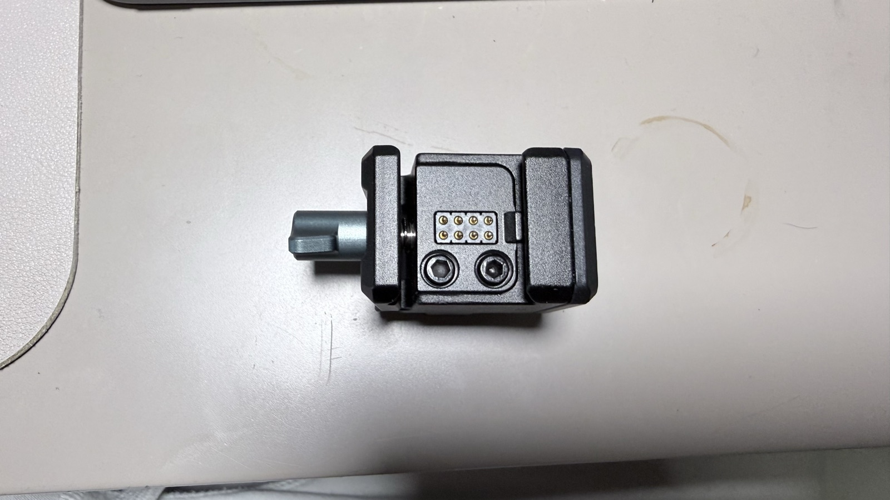

# Morsetto NATO con pogo pin

Morsetto stampabile in 3D che si aggancia alla guida NATO della porta RSA del gimbal e porta i segnali
(alimentazione e CAN) all'ESP32 tramite un connettore pogo 2×4.



Il riferimento è il morsetto di un accessorio DJI: misura 34,7 mm trasversalmente alla guida (ganasce comprese)
e 26,2 mm lungo la guida, con 8 pogo pin su due file da 4 al centro del canale.

## File

| File | Contenuto |
|---|---|
| [rsa_clamp.py](rsa_clamp.py) | Modello parametrico: tutte le misure sono in cima al file |
| [stl/rsa_clamp_body.stl](stl/rsa_clamp_body.stl) | Corpo con ganascia fissa, sede del connettore, vano cavi |
| [stl/rsa_clamp_jaw.stl](stl/rsa_clamp_jaw.stl) | Ganascia mobile |
| [stl/rsa_clamp_lid.stl](stl/rsa_clamp_lid.stl) | Coperchio del vano cavi (da incollare) |

Per rigenerare gli STL dopo aver cambiato un parametro:

```sh
python3 -m venv hardware/.venv
hardware/.venv/bin/pip install manifold3d numpy
hardware/.venv/bin/python hardware/rsa_clamp.py
```

## Prima della stampa: misure da verificare

I valori segnati `MEASURE` in [rsa_clamp.py](rsa_clamp.py) sono stime ricavate dalla foto. Da controllare con
il calibro sul morsetto di riferimento:

| Parametro | Valore attuale | Cosa misurare |
|---|---|---|
| `HEIGHT` | 12,0 mm | Altezza del morsetto |
| `RAIL_W` | 21,2 mm | Larghezza massima del canale a coda di rondine (sul fondo) |
| `DOVETAIL_DEPTH` | 2,6 mm | Profondità del sottosquadro (dal fondo del canale al bordo delle ganasce) |
| `PIN_PITCH` | 2,0 mm | Distanza tra i centri di due pin vicini. Meglio misurare tra i pin esterni e dividere per 3 |
| `CONNECTOR_CENTER_Y` | 13,1 mm | Distanza del centro dei pin da un'estremità del morsetto (dalla foto ~11,5 mm) |
| `CONNECTOR_X`, `CONNECTOR_Y` | 10 × 5 mm | Dimensioni del connettore pogo che compri |

Il modello attuale dà un'apertura del canale di 16,3 mm, che corrisponde a quanto si vede nella foto.

Il primo pezzo conviene stamparlo solo come prova di aggancio sulla guida, prima di montare l'elettronica.

## Materiali

| Pezzo | Quantità |
|---|---|
| Connettore pogo 2×4 con passo pari a `PIN_PITCH` | 1 |
| Vite M4 a testa zigrinata o manopola M4, lunghezza ~12 mm | 1 |
| Inserto filettato a caldo M4 (foro 5,6 mm, lunghezza ≤ 5 mm) | 1 |
| Spine in acciaio Ø3 × 10 mm | 2 |
| Resistenza 47 kΩ (pull-down di AD_COM) | 1 |
| Cavo schermato a 4 poli (VCC, GND, CANH, CANL) | |

## Stampa

- PETG o ASA, meglio del PLA vicino ai motori del gimbal e per l'elasticità dei ganci.
- Corpo e ganascia così come esportati, con la base piatta sul piatto. Il canale è rivolto verso l'alto, quindi
  i ganci a 45° si stampano senza supporti.
- Layer 0,12–0,16 mm, 4 perimetri, riempimento 40% o più.

## Montaggio

1. Inserto M4 a caldo nel foro centrale sul lato sinistro del corpo.
2. Spine Ø3 a pressione nei due fori laterali del corpo: la ganascia mobile ci scorre sopra.
3. Connettore pogo nella sede, con le punte che sporgono dal fondo del canale di circa metà della corsa delle
   molle. Fissalo con colla epossidica.
4. Saldatura dei fili e della resistenza da 47 kΩ tra AD_COM e GND nel vano; uscita del cavo dal foro posteriore.
5. Coperchio incollato sotto il vano.

Per agganciare il morsetto: allenta la manopola e apri la ganascia di almeno 3 mm, inclina il morsetto
infilando il gancio fisso sotto un lato della guida, abbassalo e stringi.

## Ascoltare il bus con il ricevitore SmallRig 3920

Il ricevitore del controller wireless SmallRig 3920 si monta sulla porta RSA e comanda il gimbal: è il modo più
sicuro per verificare protocollo e contatti sul gimbal reale.

1. **Apri il ricevitore** e fotografa la scheda dai due lati. Servono la sigla del chip principale e quella del
   transceiver CAN (un SOIC-8 vicino ai pogo pin, tipo TJA1051 o SN65HVD23x).
2. **Trova i contatti del CAN.** Nei transceiver comuni il pin 7 è CANH, il 6 è CANL e il 2 è GND: verificalo sul
   datasheet del chip trovato.
3. **Controlla la terminazione.** A gimbal spento misura la resistenza tra CANH e CANL. Con circa 120 Ω lascia la
   resistenza del modulo SN65HVD230; con circa 60 Ω il bus è già terminato ai due capi, quindi va tolta quella
   del modulo.
4. **Collega tre fili sottili** (CANH, CANL, GND) al modulo SN65HVD230, a sua volta collegato all'ESP32 alimentato
   dall'USB del computer. Non collegare la VCC della porta.
5. **Avvia lo sniffer** dalla console seriale con `sniff` oppure `sniff raw` (tutti i frame). L'ESP32 è in sola
   ricezione: non trasmette e non conferma i messaggi, quindi non disturba gimbal e ricevitore. Ogni comando del
   3920 compare decodificato, se è R SDK, oppure come riepilogo dei byte per ID. `sniff off` torna alla modalità
   normale.

## Identificare gli 8 contatti

La documentazione DJI descrive 6 contatti per l'RS 2 (VCC 8 V, CANL, SBUS_RX, CANH, AD_COM, GND), mentre questa
porta ne ha 8. La mappatura sull'RS 4 va quindi verificata sulle piazzole del gimbal, con il multimetro:

1. **GND**, a gimbal spento: continuità tra ogni piazzola e il guscio metallico di una porta USB-C del gimbal.
2. **AD_COM, CANH, CANL**, a gimbal acceso e senza accessori: misura la tensione di ogni piazzola verso GND.
   - AD_COM è tirato in alto da una resistenza interna, quindi mostra una tensione.
   - CANH e CANL a riposo stanno entrambe intorno a 2,5 V.
   - VCC dovrebbe essere a 0 V, perché la porta non eroga finché non rileva un accessorio.
3. **VCC**: collega 47 kΩ tra la piazzola candidata AD_COM e GND. Se è quella giusta, su VCC compaiono circa 8 V.
4. **CANH/CANL**: se il comando `v` della console non riceve risposta, scambia i due fili. Invertirli non
   danneggia nulla.

Annota il risultato in questa tabella e aggiorna il modello se serve:

| Posizione (fila, colonna) | Segnale |
|---|---|
| A1 | |
| A2 | |
| A3 | |
| A4 | |
| B1 | |
| B2 | |
| B3 | |
| B4 | |

Non collegare l'ESP32 finché VCC (8 V) non è identificato con certezza: va portato a 5 V con un convertitore
buck prima di raggiungere la scheda.
